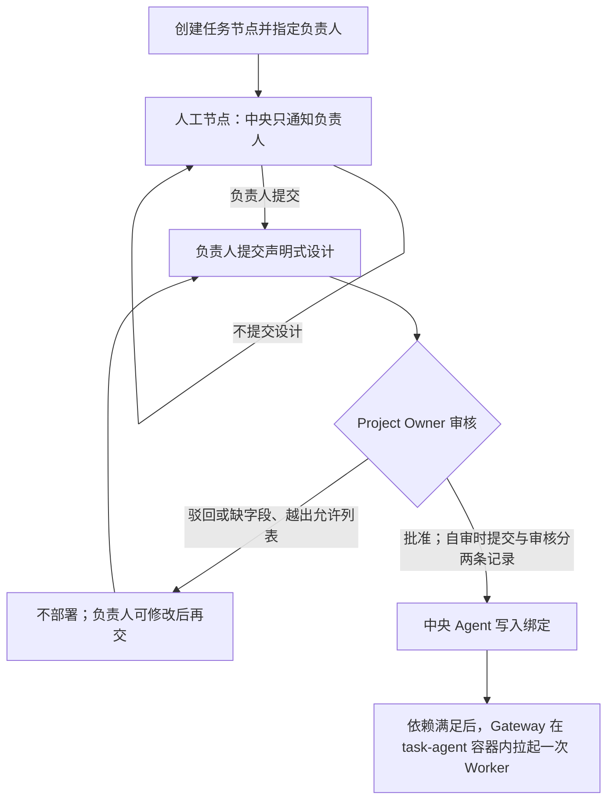

# Task Agent：创建到部署（已被取代）

> **本文件已作废（2026-10-21）。** Task Agent 改由研究员在自己电脑上自持，中央不再部署、绑定或审核 agent 设计。现行结论见工单「Task Agent 改由研究员端侧自持」。以下原文保留，仅供追溯当时的讨论。

任务节点创建时就指定负责人。没有已部署的绑定之前，节点按人工节点处理。设计是声明式方案，不是新的 Python 源码。

## 流程

## 方案里有什么

已注册模板、任务指令、允许列表中的模型、允许列表中的 MCP 引用，以及是否保留会话历史。缺字段或引用允许列表之外的模型或 MCP 时，不得批准。中央 Agent 不补设计，也不执行研究员提交的代码。

## 谁能做什么

| 角色 | 能做 | 不能做 |
| --- | --- | --- |
| 节点负责人 | 提交或修改本节点的设计 | 审核自己的设计，除非本人就是 Project Owner；直接部署 |
| 其他研究员 | — | 代交该节点的设计 |
| Project Owner | 批准或驳回 | 把提交和审核并成一次操作 |
| 中央 Agent | 批准后部署 | 在未批准时部署，或替方案补字段 |

## 部署落在哪

中央服务器用 Compose 跑多个容器。`task-agent` 是其中单独的一个容器，源码只装一次。部署是中央 Agent 调用 Gateway 写入绑定，不是复制源码，也不为每个方案新建容器或宿主机端口。Worker 是该容器内的短生命周期进程，执行结束即退出。

## 作废的原因

1. 中央 Agent 要「部署」，就必须把研究员提交的设计落成可执行形态，等于开出一条执行研究员代码的通道，与本文第 29 行「不执行研究员提交的代码」相冲突。
2. 需要绑定表、注册表、待生效状态、部署与启动的区分，而 `registery` 至今没有字段契约。
3. 研究员无法自己调试自己的 agent，改一行要等审核和部署。
4. 中央要维护 task-agent 集群，且每个 agent 的模型与凭据都堆在中央。

## 现在的模型

研究员在自己的电脑上写 task-agent，自己启动、自己重启、自己改。中央服务器上没有 task-agent 服务。

- **上游消息**：研究员的 agent 主动连接中央消息队列，订阅自己负责的 TaskNode。出站连接即可，端侧不需要公网可达地址。
- **权限**：按主体登记可用的 MCP 能力。研究员只能登记部分 MCP，Project Owner 可以登记全部。这是软约束，平台不防御研究员修改自己的 agent。
- **结果回平台**：agent 把结果作为草稿提交到中央草稿箱的 `mapping` 或 `wiki` 命名空间。
- **下游交接**：挂在领域正式版本发布上，不挂在执行状态机上。草稿 → 一审 → 候选 → Project Owner 批准 → 正式版本发布 → 触发下游交接。
